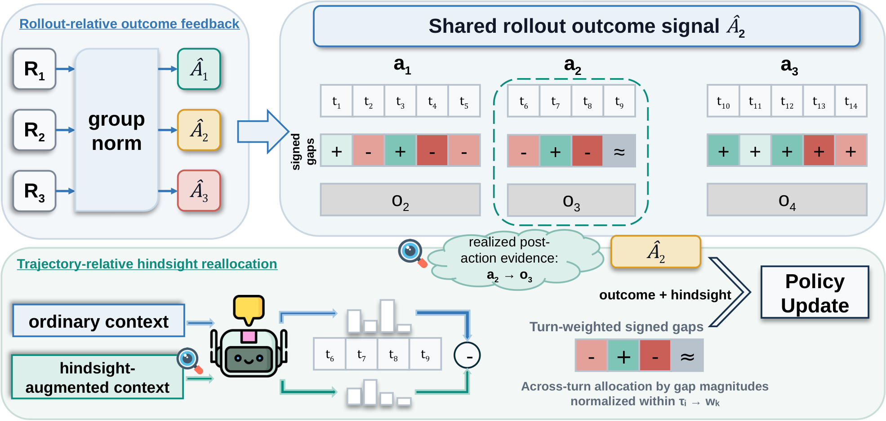

# TRIAL

Official code for *Trajectory-Relative Hindsight Allocation for Agentic Reinforcement Learning*.



## Install

```bash
conda create -n trial python=3.10 -y
conda activate trial
pip install torch==2.6.0 --index-url https://download.pytorch.org/whl/cu124
pip install -r requirements.txt
pip install flash-attn --no-build-isolation
```

## Environments

```bash
bash scripts/setup_alfworld.sh
bash scripts/setup_webshop.sh
```

## Training

```bash
export MODEL_PATH=Qwen/Qwen2.5-3B-Instruct
export NUM_GPUS=8

BENCHMARK=alfworld bash scripts/run.sh
BENCHMARK=webshop bash scripts/run.sh
```

## Evaluation

```bash
export CHECKPOINT=/path/to/run/global_step_150

BENCHMARK=alfworld bash scripts/evaluate.sh
BENCHMARK=webshop bash scripts/evaluate.sh
```

Evaluation loads the checkpoint without training. It evaluates all 134 ALFWorld in-distribution games or all 500 WebShop test goals.

```bibtex
@misc{trial,
  title = {Trajectory-Relative Hindsight Allocation for Agentic Reinforcement Learning},
  note = {Citation metadata will be added with the public paper release}
}
```
